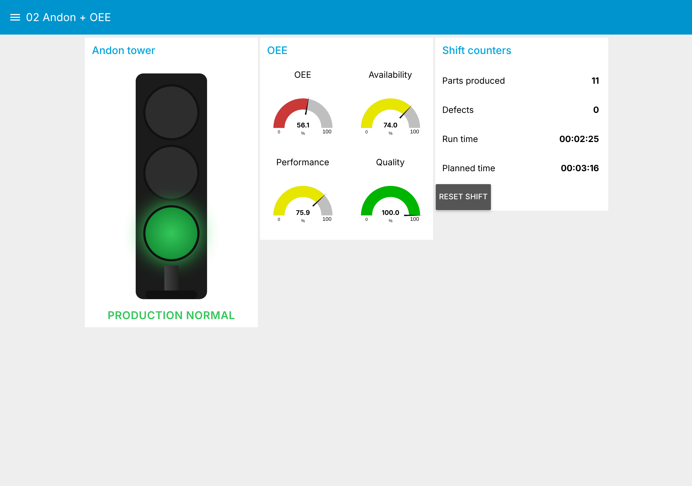

# Automation Portfolio · Industrial Automation | IIoT | Industry 4.0

[](https://github.com/MatheusEduGarcia/automation-portfolio/actions/workflows/ci.yml)

Hands-on projects in industrial automation, IIoT and industrial data: from
PLC logic and embedded devices on the shop floor to MQTT, historians and
dashboards on the IT side.

## About

Control and Automation Engineer working on OT/IT integration, data
connectivity and OEE enablement.

- PLC / OT systems and shop-floor integration (IEC 61131-3, CODESYS)
- IIoT: MQTT, OPC UA, edge computing, Unified Namespace
- OEE, downtime and Andon systems, real-time dashboards
- Data: Python, SQL, time-series databases, Power BI

## Featured project

### [CAC-01 · Compressed Air Plant: PLC → OPC UA → MQTT → TimescaleDB](https://github.com/MatheusEduGarcia/compressed-air-plant-opcua)

Three-compressor air plant programmed in ST and Ladder (MasterTool X /
CODESYS), exposed over OPC UA, published to an MQTT Unified Namespace,
stored in TimescaleDB and shown in Grafana. Includes a Python digital twin
of the PLC so the whole stack runs with `docker compose up`.

## Projects in this repository

| # | Project | What it shows | Stack |
|---|---|---|---|
| 01 | [ESP32 Remote I/O over MQTT](projects/01-esp32-mqtt-remote-io/) | 8 in / 8 out over MQTT with command confirmation, Last Will, machine telemetry simulator | ESP32, MQTT, Node-RED |
| 02 | [ESP32 Andon Tower + OEE](projects/02-esp32-mqtt-andon-system/) | Operator station computing Availability, Performance, Quality and OEE on the device, Andon dashboard | ESP32, MQTT, Node-RED Dashboard |
| 03 | [Node-RED IIoT Lab](projects/03-node-red-iiot-lab/) | `docker compose up` runs 01 and 02 with virtual ESP32s, no hardware needed | Docker, Mosquitto, Node-RED |



### Try it in one minute

```bash
git clone https://github.com/MatheusEduGarcia/automation-portfolio.git
cd automation-portfolio/projects/03-node-red-iiot-lab
docker compose up -d --build
# open http://localhost:1880/ui
```

## Firmware credentials

The ESP32 sketches read Wi-Fi and broker settings from `secrets.h`, which is
not committed. In each sketch folder, copy `secrets.example.h` to
`secrets.h` and fill in your values.

## Tech stack

MQTT · OPC UA · Node-RED · ESP32 · CODESYS · Python · SQL · TimescaleDB ·
Grafana · Power BI · Docker

## Contact

- LinkedIn: https://www.linkedin.com/in/matheuseduardorgarcia/
- Email: matheuseduardorgarcia@gmail.com
