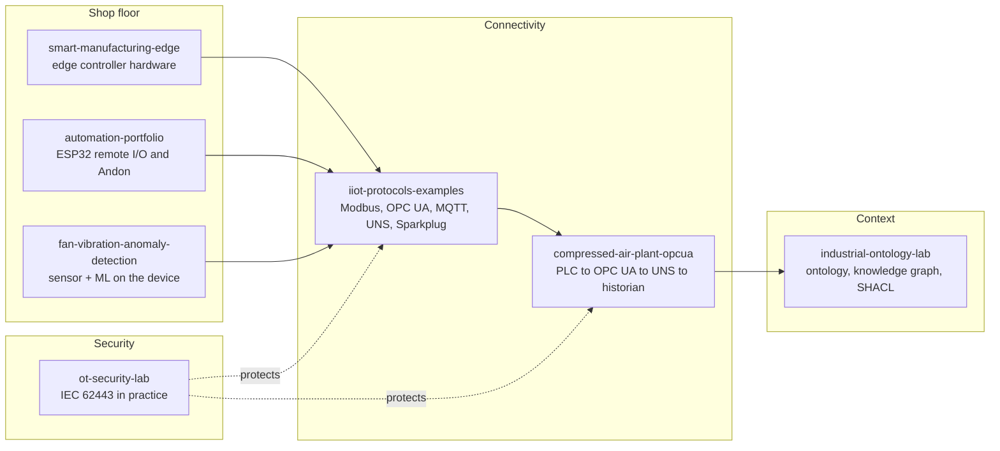
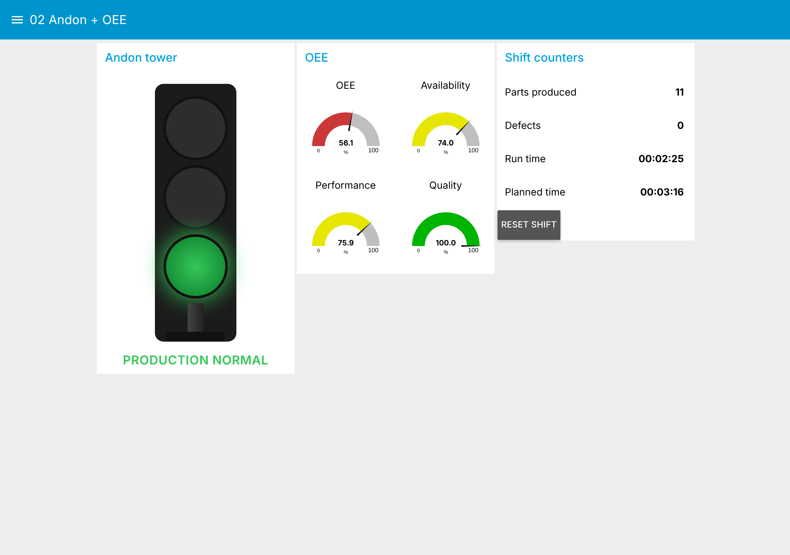

# Automation Portfolio · Industrial Automation, IIoT and Industry 4.0

**Matheus Garcia**, Control and Automation Engineer working on OT/IT integration, industrial data and OEE.

This repository is the index of my public work: seven repositories that together cover the path of industrial data, from a sensor and a PLC on the shop floor to context, security and machine learning. Everything runs on a laptop, most of it without hardware, and the study material is written as executed notebooks.

[](https://github.com/MatheusEduGarcia/automation-portfolio/actions/workflows/ci.yml)
[](https://www.linkedin.com/in/matheuseduardorgarcia/)

---

## The map



## Start here

| If you want to see | Go to | Time |
|---|---|---|
| a complete plant, PLC to dashboard, in one `docker compose up` | [compressed-air-plant-opcua](https://github.com/MatheusEduGarcia/compressed-air-plant-opcua) | 10 min |
| how I teach industrial protocols | [iiot-protocols-examples](https://github.com/MatheusEduGarcia/iiot-protocols-examples), lesson 01 | 30 min |
| OT security tied to the standards, with tests as evidence | [ot-security-lab](https://github.com/MatheusEduGarcia/ot-security-lab) | 15 min |
| data modelling beyond tags | [industrial-ontology-lab](https://github.com/MatheusEduGarcia/industrial-ontology-lab) | 15 min |
| embedded and machine learning with honest limits | [fan-vibration-anomaly-detection](https://github.com/MatheusEduGarcia/fan-vibration-anomaly-detection) | 15 min |

## The repositories

### Connectivity and data

| | |
|---|---|
| <a href="https://github.com/MatheusEduGarcia/compressed-air-plant-opcua"></a> | **[compressed-air-plant-opcua](https://github.com/MatheusEduGarcia/compressed-air-plant-opcua)**<br/>Three-compressor air plant in ST and Ladder (MasterTool X / CODESYS), exposed over OPC UA, published to an MQTT Unified Namespace, stored in TimescaleDB and shown in Grafana. A Python digital twin of the PLC lets the whole stack run without hardware.<br/>`IEC 61131-3` `OPC UA` `MQTT` `TimescaleDB` `Grafana` |
| <a href="https://github.com/MatheusEduGarcia/iiot-protocols-examples"></a> | **[iiot-protocols-examples](https://github.com/MatheusEduGarcia/iiot-protocols-examples)**<br/>A ten-lesson course: Modbus, OPC UA, MQTT, Unified Namespace, Sparkplug B, edge gateway, historian and OEE, ISA-18.2 alarms. Each lesson is runnable code plus an executed study notebook with predictions, a quiz and exercises.<br/>`Modbus` `OPC UA` `MQTT` `Sparkplug B` `OEE` `ISA-18.2` |

### Context and security

| | |
|---|---|
| <a href="https://github.com/MatheusEduGarcia/industrial-ontology-lab"></a> | **[industrial-ontology-lab](https://github.com/MatheusEduGarcia/industrial-ontology-lab)**<br/>A semantic layer for a plant: core ontology plus production, maintenance, quality, energy and inventory extensions, SHACL data contracts, cross-domain SPARQL, a live UNS to graph bridge and a Neo4j export.<br/>`RDF` `OWL` `SHACL` `SPARQL` `Neo4j` `ISA-95` |
| <a href="https://github.com/MatheusEduGarcia/ot-security-lab"></a> | **[ot-security-lab](https://github.com/MatheusEduGarcia/ot-security-lab)**<br/>A plant taken from as found to defended: passive inventory, zones and conduits, risk assessment, a real default-deny firewall, MQTT and OPC UA hardening, a Modbus intrusion detector and a compliance matrix computed from the test run.<br/>`IEC 62443` `NIST CSF 2.0` `MITRE ATT&CK for ICS` |

### Devices and machine learning

| | |
|---|---|
| <a href="https://github.com/MatheusEduGarcia/fan-vibration-anomaly-detection"></a> | **[fan-vibration-anomaly-detection](https://github.com/MatheusEduGarcia/fan-vibration-anomaly-detection)**<br/>A battery-powered ESP32-C3 and ADXL345 sensor on a ceiling fan, with Mahalanobis, Autoencoder, 1D-CNN and four baselines compared, including the test where they fail to generalize to an unseen speed.<br/>`ESP32-C3` `TinyML` `anomaly detection` `Keras` |
| <a href="https://github.com/MatheusEduGarcia/smart-manufacturing-edge"></a> | **[smart-manufacturing-edge](https://github.com/MatheusEduGarcia/smart-manufacturing-edge)**<br/>Engineering documentation for an industrial edge controller: ESP32, Ethernet, isolated RS-485, 24 V I/O. Requirements, architecture, engineering plan and an audit of the reference board.<br/>`hardware design` `KiCad` `RS-485` `24 V I/O` |

## Projects in this repository

ESP32 and Node-RED projects that run with or without hardware.

| # | Project | What it shows | Stack |
|---|---|---|---|
| 01 | [ESP32 Remote I/O over MQTT](projects/01-esp32-mqtt-remote-io/) | 8 inputs and 8 outputs over MQTT with command confirmation, Last Will and a machine telemetry simulator | ESP32, MQTT, Node-RED |
| 02 | [ESP32 Andon Tower + OEE](projects/02-esp32-mqtt-andon-system/) | operator station computing Availability, Performance, Quality and OEE on the device, with an Andon dashboard | ESP32, MQTT, Node-RED Dashboard |
| 03 | [Node-RED IIoT Lab](projects/03-node-red-iiot-lab/) | `docker compose up` runs 01 and 02 with virtual ESP32s, no hardware needed | Docker, Mosquitto, Node-RED |



### Try it in one minute

```bash
git clone https://github.com/MatheusEduGarcia/automation-portfolio.git
cd automation-portfolio/projects/03-node-red-iiot-lab
docker compose up -d --build
# open http://localhost:1880/ui
```

The ESP32 sketches read Wi-Fi and broker settings from `secrets.h`, which is not committed. In each sketch folder, copy `secrets.example.h` to `secrets.h` and fill in your values.

## How I work

- **Runnable first.** Every repository starts with a command that works on a clean machine, and CI proves it.
- **Simulate what is missing.** A digital twin, a synthetic capture or a virtual ESP32 stands in for hardware, so anyone can reproduce the result.
- **Show the limits.** Results include what the numbers do not say: confounded factors, tests that fail, controls still planned.
- **Teach while building.** Study notebooks are committed executed, with a prediction before each experiment and a quiz at the end.

## Skills

| Area | Tools and standards |
|---|---|
| PLC and OT | IEC 61131-3 (ST, Ladder), CODESYS, MasterTool X, ISA-95, ISA-18.2 |
| Connectivity | Modbus TCP/RTU, OPC UA, MQTT, Sparkplug B, Unified Namespace, Node-RED |
| Data | Python, SQL, TimescaleDB, Grafana, Power BI, OEE and downtime analysis |
| Context | RDF, OWL, SHACL, SPARQL, Neo4j |
| OT security | IEC 62443, NIST SP 800-82, NIST CSF 2.0, MITRE ATT&CK for ICS |
| Embedded and ML | ESP32, KiCad, TinyML, anomaly detection |

## Contact

- LinkedIn: https://www.linkedin.com/in/matheuseduardorgarcia/
- Email: matheuseduardorgarcia@gmail.com
