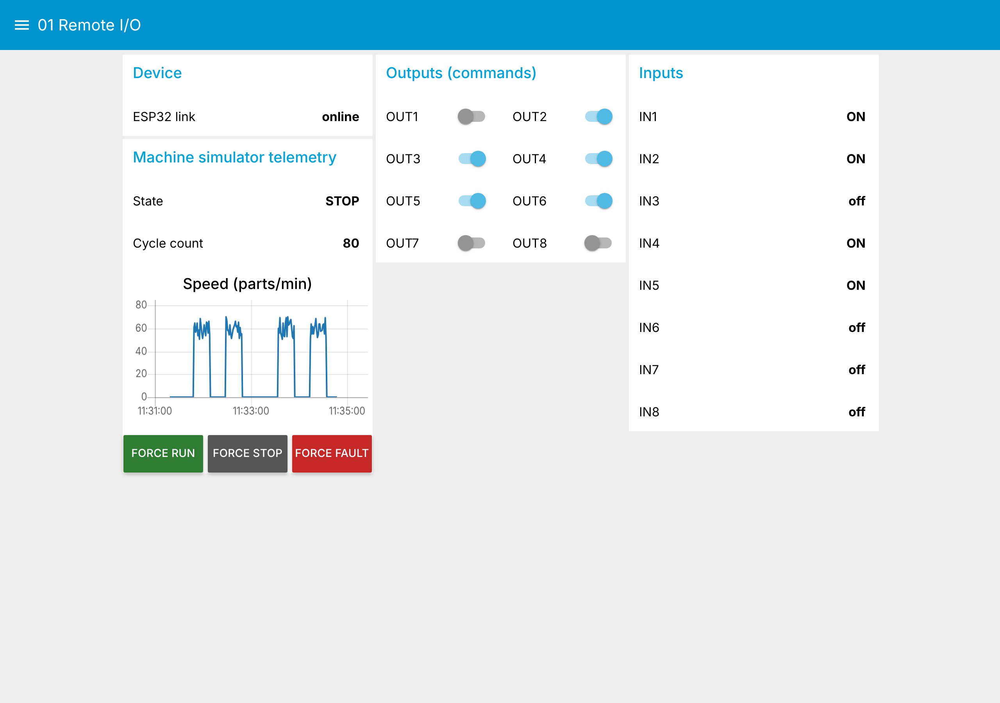
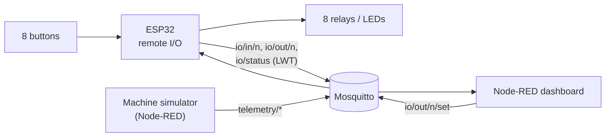
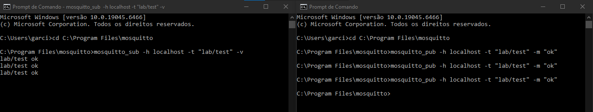
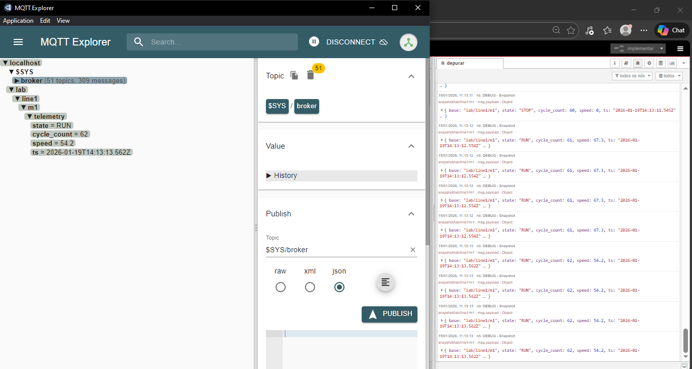
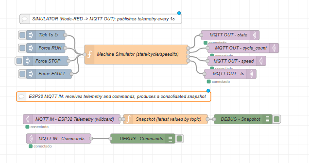

# 01 · ESP32 Remote I/O over MQTT

An ESP32 used as an **8 in / 8 out remote I/O module over MQTT**: buttons
publish input events, relays or LEDs follow commands from the network and
confirm their state back. The same project includes a **machine telemetry
simulator** in Node-RED (RUN / STOP / FAULT, cycle count, speed) used to
build and test the topic structure before any hardware was connected.

*Dashboard running with the virtual ESP32, see [03 · IIoT Lab](../03-node-red-iiot-lab/).*

## What it shows

* **Command and confirmation pattern**: the dashboard writes `io/out/<n>/set`,
  the device applies it and answers on `io/out/<n>` (retained). The switch
  only shows what the device confirmed, never what was requested.
* **Device health** with MQTT Last Will: `io/status` turns `offline` on its
  own when the ESP32 drops off.
* **Non-blocking reconnect**: Wi-Fi and MQTT retry without freezing the loop,
  so inputs keep being scanned while the broker is down.
* **Toggle or momentary inputs** (`MODO_TOGGLE` in the firmware), 50 ms
  debounce.

## Architecture

## Pin map

| Channel | Input GPIO | Output GPIO |
|---|---|---|
| 1 | 32 | 23 |
| 2 | 33 | 21 |
| 3 | 4 | 22 |
| 4 | 15 | 19 |
| 5 | 27 | 18 |
| 6 | 14 | 2 |
| 7 | 12 | 25 |
| 8 | 13 | 26 |

Inputs use the internal pull-up (LOW = pressed). Topics use channel index
`0..7`.

## MQTT topics

Base: `lab/line1/m1`

| Topic | Direction | Payload | Retained |
|---|---|---|---|
| `…/io/in/<n>` | ESP32 → | `0` / `1` | no |
| `…/io/out/<n>/set` | → ESP32 | `0` `1` `true` `false` `on` `off` | no |
| `…/io/out/<n>` | ESP32 → | `0` / `1` (confirmed state) | yes |
| `…/io/status` | ESP32 → | `online` / `offline` (Last Will) | yes |
| `…/telemetry/state` | simulator → | `RUN` / `STOP` / `FAULT` | no |
| `…/telemetry/cycle_count` | simulator → | integer | no |
| `…/telemetry/speed` | simulator → | parts/min | no |
| `…/telemetry/ts` | simulator → | ISO 8601 timestamp | no |

## How to run

**Without hardware:** start the [IIoT Lab](../03-node-red-iiot-lab/) and open
http://localhost:1880/ui, tab *01 Remote I/O*. Flip the output switches: the
virtual ESP32 confirms them. Use the *Force RUN / STOP / FAULT* buttons to
drive the simulator.

**With an ESP32:**

1. Open `firmware/esp32_mqtt_io/esp32_mqtt_io.ino` in Arduino IDE 2 (board:
   ESP32 Dev Module, library: PubSubClient).
2. Copy `secrets.example.h` to `secrets.h` in the same folder and set Wi-Fi
   and the broker IP. `secrets.h` is ignored by git.
3. Upload and open the Serial Monitor at 115200 baud.
4. Run the lab with `SIMULATE_DEVICE=false`.

To use only the flow on an existing Node-RED: install `node-red-dashboard`,
then **Import** [`flows/remote-io.flow.json`](flows/remote-io.flow.json) and
set the environment variable `MQTT_HOST`.

## Evidence from the first phase

| Mosquitto pub/sub test | MQTT Explorer | Node-RED simulator |
|---|---|---|
|  |  |  |

## Roadmap

- [x] Phase 0: local Mosquitto, Node-RED simulator, topic convention
- [x] Phase 1: ESP32 remote I/O with confirmation and Last Will
- [x] Phase 2: dashboard
- [ ] Phase 3: HiveMQ Cloud with TLS and credentials, same topics
