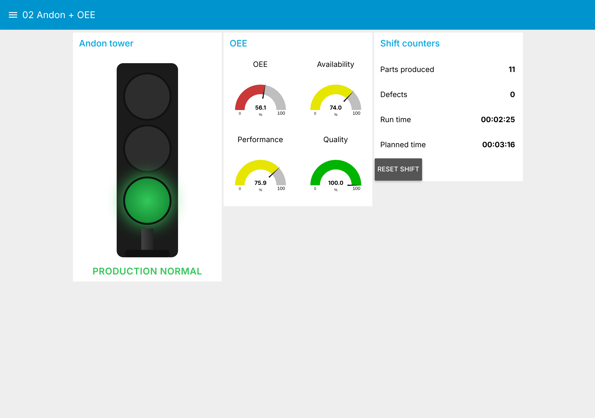
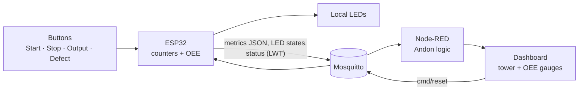

# 02 · ESP32 Andon Tower + OEE over MQTT


An ESP32 machine station with four operator buttons (Start, Stop, Output,
Defect) that counts parts and defects, computes **OEE** on the device and
publishes it over MQTT. A Node-RED dashboard shows an **Andon tower** and the
OEE breakdown in real time.



*Dashboard running with the virtual machine (no hardware needed), see
[03 · IIoT Lab](../03-node-red-iiot-lab/).*

## What it does

* **Andon logic** with priority: offline (grey) > defect (yellow) >
  running (green) > stopped (red). Offline comes from the MQTT Last Will.
* **Shift counters**: parts, defects, run time and planned time.
* **OEE = Availability × Performance × Quality**, calculated on the ESP32:

| Factor | Formula | Source |
|---|---|---|
| Availability | run time / planned time | Start and Stop buttons, planned time = time since shift start |
| Performance | parts × ideal cycle time / run time | Output button, `IDEAL_CYCLE_S` in the firmware (10 s) |
| Quality | (parts − defects) / parts | Defect button marks one produced part as scrap |

* **Reset shift** from the dashboard (`cmd/reset`) zeroes the counters and
  starts a new planned time window.

## Architecture



## Hardware

| Component | GPIO | Notes |
|---|---|---|
| Button START | 32 | internal pull-up, LOW = pressed |
| Button STOP | 33 | |
| Button OUTPUT (part done) | 4 | |
| Button DEFECT | 15 | |
| LED START (green) | 23 | 220 Ω |
| LED STOP (red) | 16 | 220 Ω |
| LED OUTPUT (blue) | 17 | toggles on each part |
| LED DEFECT (yellow) | 19 | on for 3 s after a defect |

## MQTT topics

Base: `lab/line1/m2`

| Topic | Direction | Payload | Retained |
|---|---|---|---|
| `…/metrics` | ESP32 → | `{"running":true,"cycles":42,"defects":2,"runtime":510,"planned":600,"availability":85.0,"performance":82.4,"quality":95.2,"oee":66.7}` | yes |
| `…/status` | ESP32 → | `online` / `offline` (Last Will) | yes |
| `…/led/{start,stop,output,defect}` | ESP32 → | `0` / `1` | yes |
| `…/button/{start,stop,output,defect}` | ESP32 → | `0` / `1` (press events) | no |
| `…/led/{name}/set` | → ESP32 | `0` / `1` | no |
| `…/cmd/reset` | → ESP32 | anything, resets the shift | no |

## How to run

**Without hardware:** start the [IIoT Lab](../03-node-red-iiot-lab/) and open
http://localhost:1880/ui. A virtual machine publishes the same topics with
the same OEE math.

**With an ESP32:**

1. Open `firmware/esp32_machine_control/esp32_machine_control.ino` in Arduino
   IDE 2 (board: ESP32 Dev Module, library: PubSubClient).
2. Copy `secrets.example.h` to `secrets.h` in the same folder and set Wi-Fi
   and the broker IP. `secrets.h` is ignored by git.
3. Upload, open the Serial Monitor at 115200 baud.
4. Run the lab with `SIMULATE_DEVICE=false` so the virtual machine does not
   publish on top of the real one.

To use only the dashboard on an existing Node-RED: install
`node-red-dashboard`, then **Import** [`flows/andon-oee.flow.json`](flows/andon-oee.flow.json)
and set the environment variable `MQTT_HOST` (or edit the broker node).

## Files

```
firmware/esp32_machine_control/   Arduino sketch + secrets.example.h
flows/andon-oee.flow.json         Node-RED flow: Andon logic, OEE gauges, virtual machine
images/                           Screenshots and the original wiring/architecture images
docs/ANDON_SYSTEM.md              Andon concept, history and use cases (pt-BR)
docs/INSTALLATION.md              Step-by-step install guide (pt-BR)
```

## Limitations and next steps

* Counters live in RAM, so a power cycle loses the shift. Next: persist with
  `Preferences` (NVS).
* Planned time is "time since shift start", with no planned breaks.
* Next: downtime reasons (a stop button per reason) and history in a
  time-series database, as in
  [compressed-air-plant-opcua](https://github.com/MatheusEduGarcia/compressed-air-plant-opcua).
