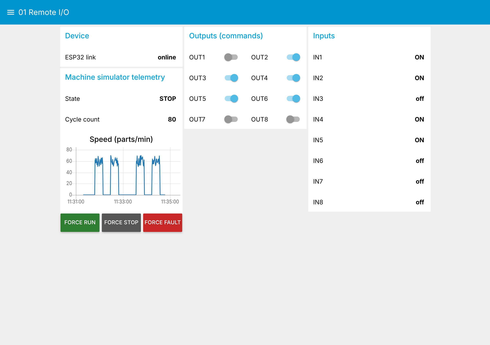
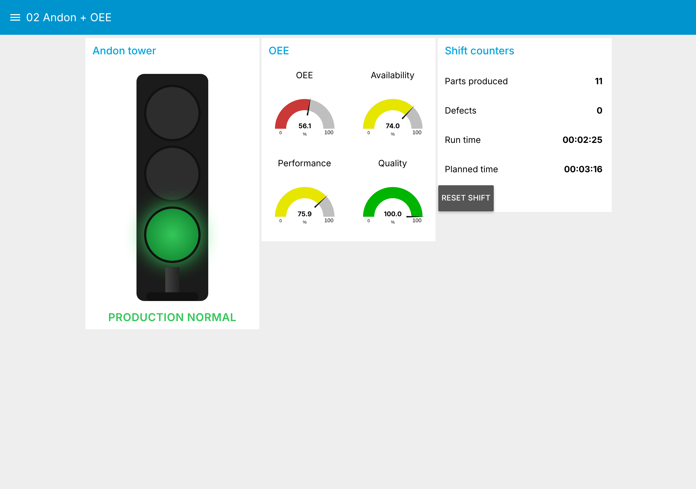

# 03 · Node-RED IIoT Lab

One command brings up an MQTT broker and Node-RED with the dashboards of
projects [01](../01-esp32-mqtt-remote-io/) and [02](../02-esp32-mqtt-andon-system/)
already loaded. **Virtual ESP32s** publish the same topics as the real
firmware, so the whole portfolio can be tried without any hardware.

```bash
cd projects/03-node-red-iiot-lab
docker compose up -d --build
```

| Service | URL |
|---|---|
| Dashboards | http://localhost:1880/ui |
| Node-RED editor | http://localhost:1880 |
| MQTT broker | `localhost:1883` (open with MQTT Explorer) |

| 01 Remote I/O | 02 Andon + OEE |
|---|---|
|  |  |

## Real hardware

Flash the ESP32 sketches pointing at this machine's IP, then run the lab
with the virtual devices off:

```bash
SIMULATE_DEVICE=false docker compose up -d
```

## How the flows are organised

* Each project owns its flow file: `projects/*/flows/*.flow.json`, importable
  on its own into any Node-RED.
* [`build_flows.py`](build_flows.py) merges them into
  [`node-red/flows.json`](node-red/flows.json), which the container loads.
  Run it again after changing a project flow.
* All flows share one MQTT broker config node that reads the host from the
  `MQTT_HOST` environment variable, so the same file works in Docker, on a
  Raspberry Pi or on a laptop.

## Patterns used

| Pattern | Where | Why |
|---|---|---|
| **Virtual device** gated by `SIMULATE_DEVICE` | both flows | Develop and demo the IT side before, or without, the OT side |
| **Command / confirmation** (`…/set` then retained state) | 01 outputs | The UI shows what the device did, not what was asked |
| **Last Will** for device health | 01 and 02 status | Offline is detected by the broker, not by polling |
| **Topic router** function with N outputs | 01 inputs and outputs | One MQTT subscription feeds many widgets |
| **JSON metrics, one publish** | 02 metrics | All OEE factors from the same instant, no torn reads |

## Files

```
docker-compose.yml     Mosquitto 2.0 + Node-RED 4.0
mosquitto.conf         Anonymous lab broker (local network only)
node-red/Dockerfile    Node-RED + node-red-dashboard
node-red/flows.json    Generated by build_flows.py
build_flows.py         Merges project flows
```
